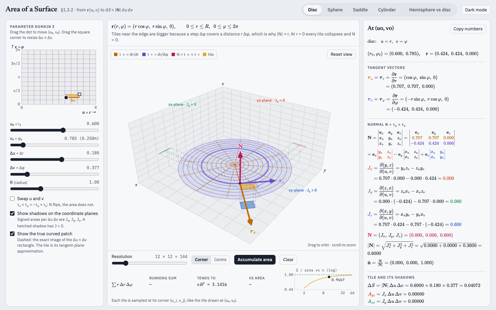

# Surface Area Explorer

An interactive 3D explorer for how the normal **N = τ_u × τ_v** and the area element **dS = |N| du dv** come from a parametric surface **r(u, v)**, written for a second-year physics vector calculus course.

**Live:** https://lucasvegamazzoni.github.io/surface-area-explorer/

## Features

- Draggable parameter domain: move and resize the Δu × Δv rectangle and watch the tile move on the surface
- Tangent vectors τ_u, τ_v and the normal N drawn on the surface
- Jacobian components J_x, J_y, J_z shown as signed shadow areas on the coordinate planes
- Area accumulation with a convergence plot against the exact area
- Sphere naive-sum comparison (R² Δθ Δφ vs R² sin θ Δθ Δφ) and the pole singularity
- Hemisphere vs disc: Stokes' theorem check, same rim and same flux of the curl

Surfaces: Disc, Sphere, Saddle, Cylinder, and the Hemisphere vs disc comparison.

## Run it

Open `index.html` in a browser, or use the live link above. It needs an internet connection to load three.js and KaTeX from CDNs.

## Built with

Plain HTML/CSS/JS, [three.js](https://threejs.org/) 0.147.0 and [KaTeX](https://katex.org/) 0.16.9. No build step.

## Adding a surface

Everything in the page (mesh, grid lines, tangents, Jacobians, tile, shadows, readouts, area accumulation, convergence plot, and the toggle at the top) is generic. To add a surface, add one config object to `SURFACES` in the maths block of `index.html` (between `BEGIN MATHS` and the end of that block). The comment above `SURFACES` lists the fields: `name`, `u` and `v` ranges, `r`, `r_u`, `r_v`, `area`, `N`, and the TeX strings for the readouts. The `disc` entry is a good one to copy.

## Licence

MIT, see [LICENSE](LICENSE).
